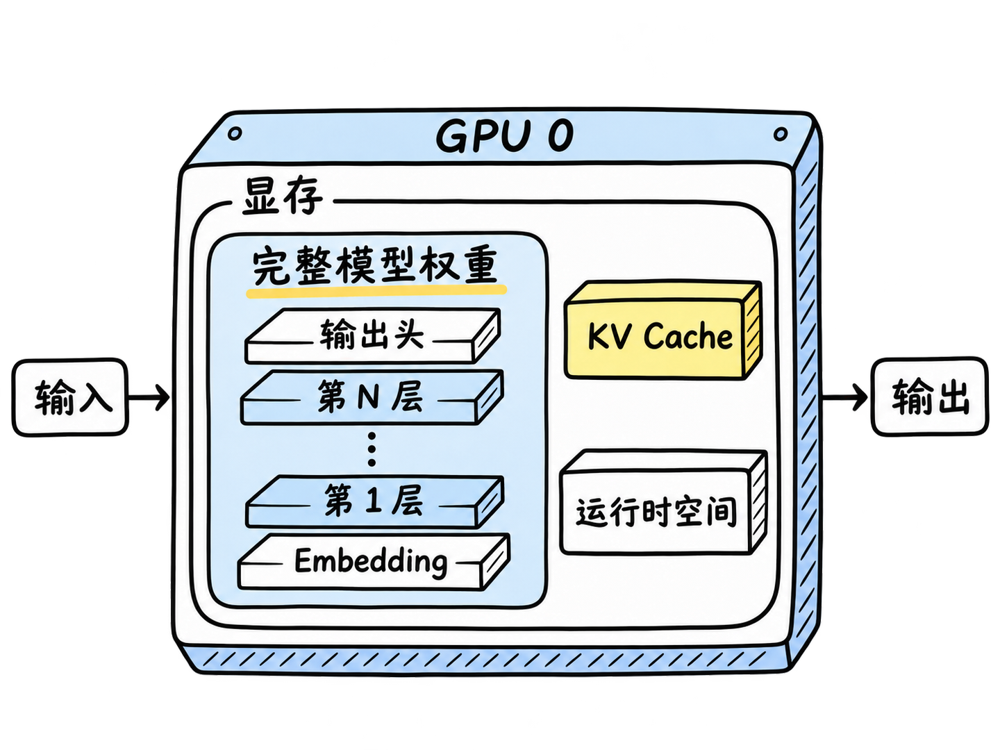
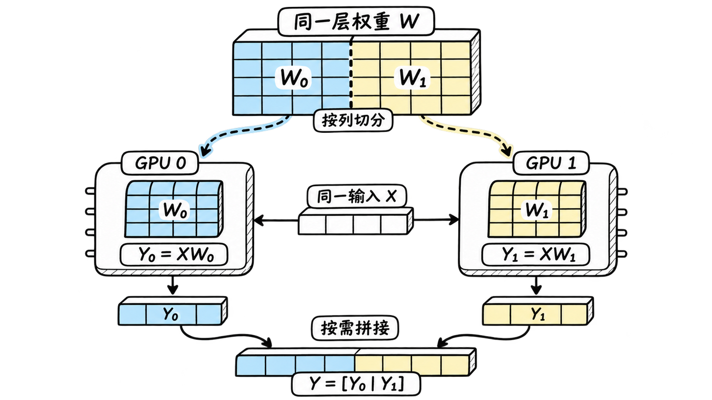
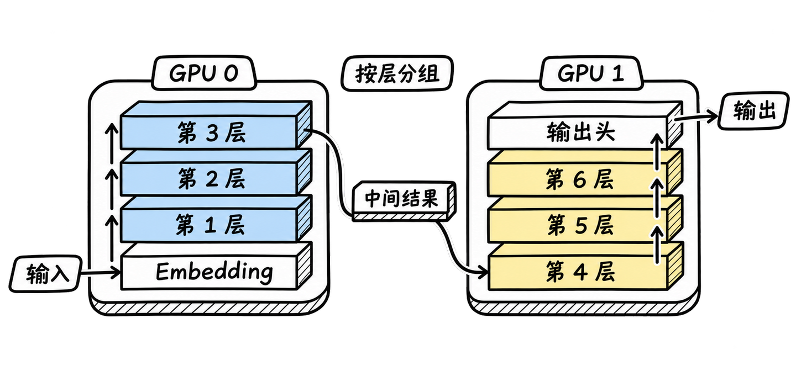
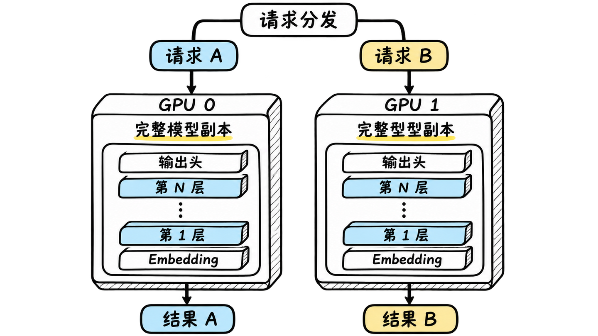
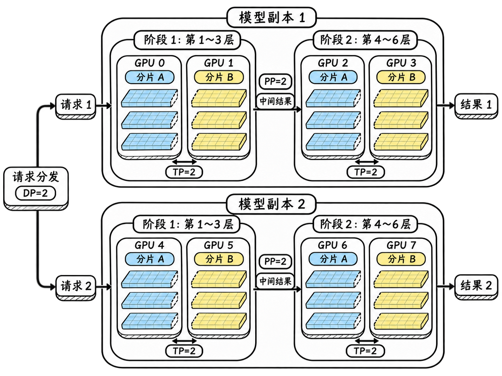
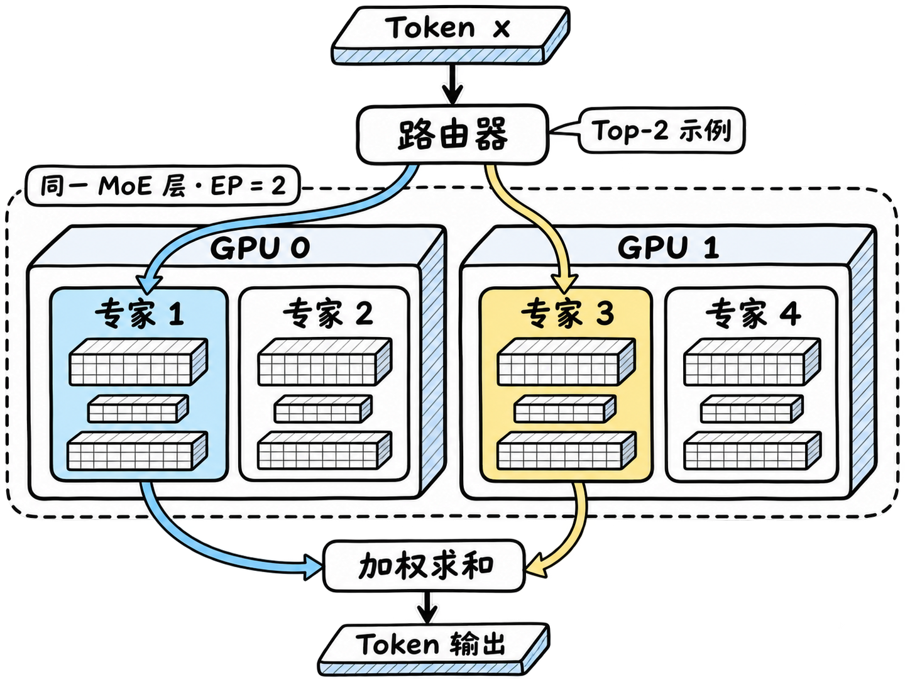
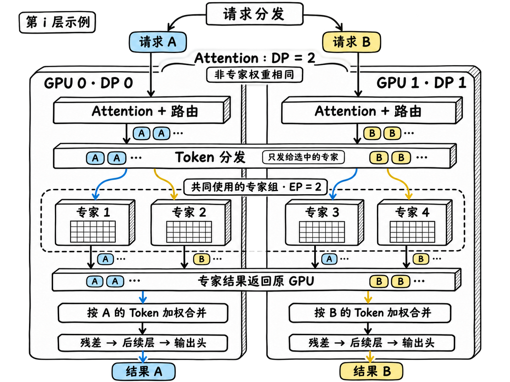
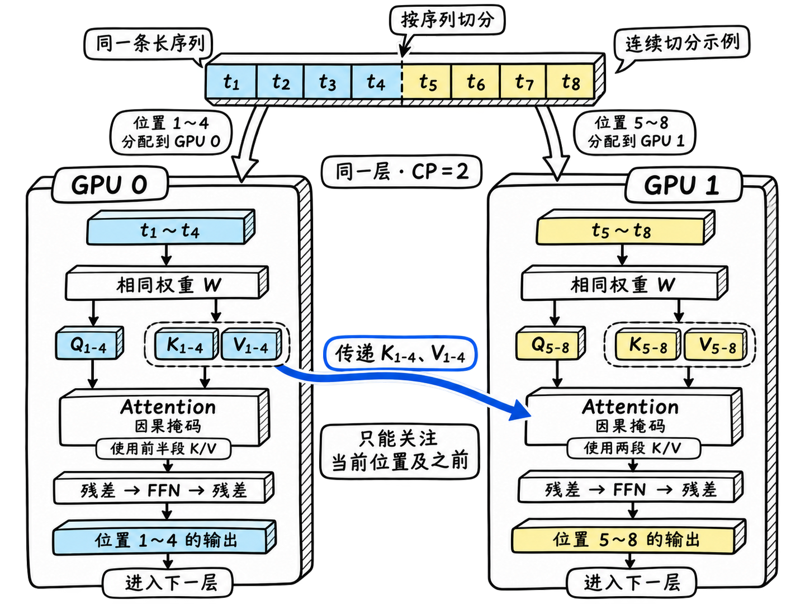
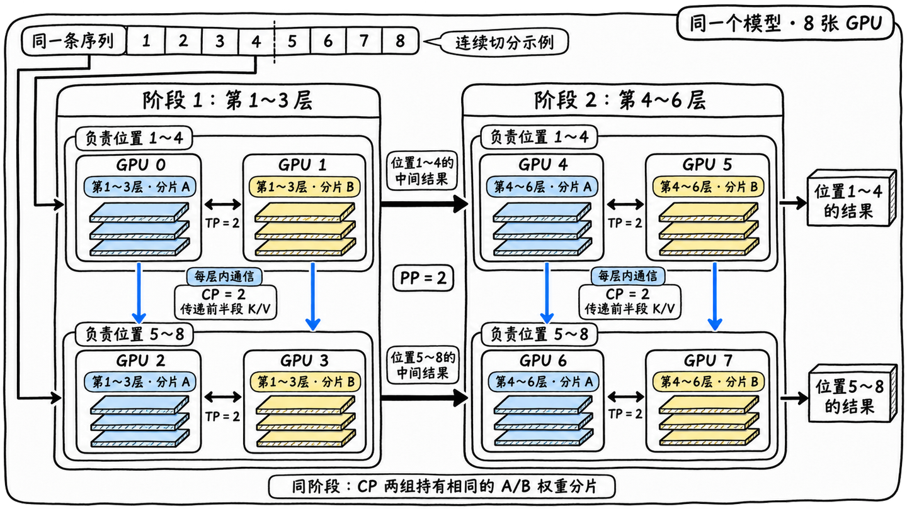

# 一口气看懂大模型并行推理：TP、PP、DP、EP 和 CP

大家好，我是暮闲。

这次跟大家分享一下大模型的并行推理，主要讲 TP、PP、DP、EP 和 CP 这五种。它们各自是怎么分的，放在一起又怎么组合，我们一个一个来看。

在讲这些并行方式之前，先做一点铺垫。如果你对大模型的结构已经很熟悉，可以直接从 TP 开始看；如果还比较模糊，我们就先看看模型里面到底有什么，再往下讲为什么要做并行。

## 先了解一下大模型的结构

我们平时用到的很多大模型，核心都是 Transformer。你可以先把它看成很多层叠在一起：最前面有 Embedding，把 Token ID 转成向量；中间是一个个 Transformer 层；最后还有输出头，得到词表上的分数，再通过采样等步骤选出下一个 token。

单独拿其中一层来看，里面有 Attention，也有 FFN 前馈网络。再往里展开，就是这些模块各自的权重矩阵，比如 Attention 里的 Q、K、V 投影权重。

所以，我们后面说把模型切开，具体切到的可能是层，也可能是层里面的这些权重。先有这个印象就可以了。

假设现在要部署一个比较小的模型，一张卡就能装下，这种情况最简单。把模型加载到显存里，输入进来，完成计算，再返回结果。

但这里要留意一下，显存里放的东西不只有模型权重。

先是权重本身，这部分很好理解。然后还有 **KV Cache**，把前面 token 算出来的 Key、Value 缓存下来，后续生成时继续用，它也要占显存。另外，计算过程中还会产生中间结果，算子和框架也需要工作空间，这就是图里的运行时空间。

因此，不能看权重刚好能装进去，就觉得这张卡一定够用。上下文变长、同时处理的请求变多，后面这两部分还会继续占空间。

等模型再大一点，一张卡装不下了，我们就会想到把它分到多张卡上。这个时候，除了计算要够快、显存要够大，**卡间通信也得跟得上**。因为数据拆开以后，各张卡算出来的结果还要交换、合并。通信太慢，模型虽然能跑起来，速度也可能差强人意。

我这里先用切蛋糕的例子来讲。把模型想象成一块很多层的蛋糕，可以横着切，也可以竖着切，还可以先横着切，再竖着切，分给不同的人。下面我们就沿着这个思路，看模型具体是怎么分到多张卡上的。

## TP：把同一层的权重切开

第一种是 TP，Tensor Parallelism，张量并行。

假设某一层的权重矩阵很大，一张卡放不下。那我们就把这个矩阵切成两份，一份放在 GPU 0，另一份放在 GPU 1。

这里画的是按列切分，原来的权重 `W` 被切成了 `W₀` 和 `W₁`，对应 TP = 2。

我们看同一个输入 `X` 进来以后会发生什么。

GPU 0 拿它和自己保存的 `W₀` 做运算，得到 `Y₀ = XW₀`；GPU 1 拿它和 `W₁` 做运算，得到 `Y₁ = XW₁`。两张卡各算了一部分，按图里的切分方式，需要完整输出时，再把它们拼成 `Y = [Y₀ | Y₁]`。

这样，同一层的权重和计算就分摊到两张卡上了。用刚才的蛋糕来理解，就是竖着切了一刀，同一层的一半在这张卡，另一半在那张卡。

这里也能很直观地看到通信是怎么增加的：各算各的还不够，后面的计算需要用这些结果，就得交换或合并。

图里举的是按列切分、按需拼接的例子。换一种切法，可能就要把局部结果求和；有些中间结果也可以先保持分片，交给后面的算子继续处理。我们先把“同一层拆给多张卡一起算”这个意思理解清楚。

所以，TP 不是卡越多就一定越快。每张卡分到的计算少了，但如果大家花了很多时间等通信，省下来的计算时间也可能被抵消。

## PP：把模型按层分开

刚才是竖着切蛋糕，我们还可以横着切。

模型有很多层，那就把前面几层放到一张卡，后面几层放到另一张卡。这里举一个小一点的数字：假设一共 6 层，第 1～3 层放 GPU 0，第 4～6 层放 GPU 1。

输入进来以后，先在 GPU 0 上完成前 3 层的计算。算好以后，把中间结果传给 GPU 1，再接着算后面的 3 层，最后得到输出。

这一种就是 PP，Pipeline Parallelism，流水线并行。

不过，前后两段计算还是有依赖的。对于同一个请求，GPU 1 要拿到 GPU 0 的结果，才能继续往下算。我们只是把层分开了，并没有让这个请求跳过中间的计算顺序。

流水线要忙起来，还需要有其他任务接上。比如 GPU 1 开始处理前一份任务时，GPU 0 可以去处理下一份。这样错开以后，两张卡才有机会同时工作。如果任务不够，或者前后两个阶段的速度差很多，就会出现空等，也就是常说的流水线气泡。[流水线执行说明](https://docs.vllm.ai/projects/ascend/en/latest/user_guide/feature_guide/pipeline_parallel.html)

### 把 TP 和 PP 放到一起

前面一刀横着切，一刀竖着切，那我们也可以把这两种切法放到一起。

还是这个 6 层模型，先按 PP = 2 分成两个阶段：第 1～3 层一组，第 4～6 层一组。结果分完以后，每组的权重还是太大，单张卡依然放不下。

那就在每个阶段里面，再按 TP = 2 切一次。第 1～3 层的权重分给两张卡，第 4～6 层的权重也分给两张卡。

这样，一个完整模型就用到了 4 张卡：

`TP 2 × PP 2 = 4 张 GPU`

前后两个阶段负责不同的层，每个阶段里的两张卡共同完成层内计算。先把这一组 4 张卡记住，接下来讲 DP 的时候还会用到。

## DP：一个实例忙不过来，就多跑几份

好，我们再换一种情况。

假设模型已经能放进一张卡了，但是请求很多，一个实例处理不过来。这个时候，最直观的办法就是再部署一个实例，把请求分开处理。

看这张图，两张卡上各有一份相同的完整模型。请求 A 交给 GPU 0，请求 B 交给 GPU 1，各自计算，各自返回结果。

这个就是 DP，Data Parallelism，数据并行。我们现在先把它理解成多跑几份模型。

这里说的“处理得更快”，主要是整个服务同时能处理的请求更多了。原来大家都排在一个实例前面，现在可以分到不同实例。单个请求内部的计算，并不会因为多了一个副本，就自动交给两张卡一起算。

### 再加上前面的 TP 和 PP

前面我们用 TP + PP，让一个模型分布在 4 张卡上。那现在想要两个完整副本，就把这一整组再复制一份。

上面 4 张卡是一份模型，下面 4 张卡又是一份模型。请求可以分到其中任意一份去处理。

进入一份模型以后，还是刚才的过程：先经过第 1～3 层，再经过第 4～6 层；每个阶段内部，又由两张卡一起计算。所以这张图里的卡数就是：

`TP 2 × PP 2 × DP 2 = 8 张 GPU`

你可以把每组 4 张卡看成一整套能完成推理的服务，再起两套，这样就比较容易理解了。

看到这里，DP 确实很像平时说的扩副本。对于普通的 Dense，也就是稠密模型，我们先这样理解就可以。不过到了 MoE 模型，还能有另一种组合：不同 DP 分组可以共同使用一组分布式专家。

要把这件事说清楚，我们先来看 EP。

## EP：把专家放到不同的 GPU 上

MoE 是 Mixture of Experts，混合专家模型。里面的 E 就是 Expert，专家。EP 的全称是 Expert Parallelism，也就是专家并行。

这个“专家”大家不要误会成提前安排好的数学专家、写作专家。具体到模型结构里，它通常是一组带有独立参数的 FFN 子网络。路由器根据当前 token，选择其中几个专家参与计算，再把它们的结果合起来。像 Mixtral，就采用了为每个 token 选择两个专家的方式。[Mixtral 论文](https://arxiv.org/abs/2401.04088)

我们拿 4 个专家举例。GPU 0 上放专家 1 和专家 2，GPU 1 上放专家 3 和专家 4。

假设一个 token 进来，路由器选中了专家 1 和专家 3。那它的隐藏表示就要分别送到两张卡上，让对应的专家去算。算完以后，再把结果拿回来合并。

比如，这次分给两个专家的合并系数分别是 0.6 和 0.4，那就可以写成：

`MoE 输出 = 0.6 × E₁(h) + 0.4 × E₃(h)`

这里的 `h` 是输入的隐藏表示，`E₁`、`E₃` 是两个专家网络。0.6 和 0.4 是这次路由给出的合并系数，和专家网络里面那些权重矩阵要分开理解。

图中写的“Token 输出”，指的是这个 token 经过专家层处理后的中间表示。后面还要继续经过模型的其他计算，最后才到生成文本的那一步。

在这个例子里，EP 做的事情就是把不同专家分摊到不同卡上。一个专家先完整地放在一张卡上，另一张卡去放其他专家。

如果连一个专家都很大，我们也可以继续在专家内部做 TP，把它的权重再切开。这就又多了一层组合，通常叫 ETP，Expert Tensor Parallelism，也就是专家内部的张量并行。[EP 和 ETP 的说明](https://docs.nvidia.com/nemo/megatron-bridge/latest/parallelisms.html)

顺着这个过程看，EP 的通信也很好理解：token 要送到对应专家那里，结果还得送回来。另外，如果很多 token 都选中了同几个专家，那几张卡就会特别忙，其他卡却可能没有多少工作，所以专家之间的负载也要考虑。

### DP + EP：不同请求共同使用专家

现在把前面的 DP 接上。

如果直接部署两套完全独立的 MoE 实例，那每套实例都要有自己的一整套专家。除此之外，我们还可以把 Attention 等非专家部分和专家部分分开安排。

假设 Attention 等非专家部分能在单卡上放下，就可以像下面这样：两张卡各放一份相同的非专家权重，分别处理不同请求；专家权重则分摊到这两张卡上，由两个请求共同使用。

我们从上往下看。请求 A 先在 GPU 0 上做 Attention，请求 B 在 GPU 1 上做。到了专家层，路由器为各自的 token 选专家。选中的专家在哪张卡，token 就发到哪张卡；算完以后，专家输出再回到原来请求所在的位置，分别合并，继续往后算。

请求 A 和请求 B 还是各自的请求，只是在专家层访问同一套分布式参数。专家层的通信需要协调执行节奏，所以它们也不再像两套独立服务那样完全互不联系。[vLLM 的 DP 与 MoE 说明](https://docs.vllm.ai/en/stable/serving/data_parallel_deployment/)

这里再提醒一下卡数。图上总共就是两张 GPU，Attention 这一部分按 DP 工作，到了专家层又按 EP 协作。同样两张卡，在不同部分做了不同的分工，所以不能再把 DP = 2 和 EP = 2 乘起来，算成 4 张卡。

以 vLLM 文档里的这种布局为例，专家组大小按 `EP_SIZE = TP_SIZE × DP_SIZE` 确定。TP = 1、DP = 2 时，专家组就可以由同样的两张卡组成。[vLLM 的 EP 部署说明](https://docs.vllm.ai/en/stable/serving/expert_parallel_deployment/)

如果还要结合 PP，就继续按层划分阶段，再看每个阶段里面的 Attention 和专家怎么放。先把卡上的东西看清楚，再算并行度，就不容易混在一起。

## CP：把同一条长序列分开算

除了前面讲的四种，还有一种是 CP。这个可能大家听得相对少一些，它的全称是 Context Parallelism，上下文并行。

我们来看一个很长的输入，比如 64K 的上下文。Prefill 的时候，这些 token 都要经过 Q、K、V 投影和 Attention 等计算。序列一长，要处理的工作也就多了。

那我们就可以把它分成两段，让 GPU 0 处理前 32K，GPU 1 处理后 32K。对应到这里，就是 CP = 2。

为了方便看图，下面只画了 8 个 token：前面 1～4 交给 GPU 0，后面 5～8 交给 GPU 1。

两张卡拿着相同的层权重，各自计算自己这段输入对应的 Q、K、V。这一部分就可以分开做。

但是到了 Attention 这里，还要考虑前后文的关系。对于带因果掩码的自回归模型，后面的 token 可以看到前面的内容，前面的 token 不能去看后面的内容。

所以，GPU 1 处理位置 5～8 时，还需要用到位置 1～4 的 K、V。你看图中间这条箭头，就是把前半段的 K、V 传到后半段去。

序列虽然分开了，前后文的依赖还在，通信就是为了解决这个问题。实际实现还会安排 KV 交换，尽量把通信和计算重叠起来。[NVIDIA 的 CP 说明](https://docs.nvidia.com/megatron-core/developer-guide/latest/user-guide/features/context_parallel.html)

这里先用前后两段来说明原理。实际计算中，后半段能看到的历史更多，两段 token 数量一样，工作量也不一定完全相同，所以还需要考虑怎么分才能让各张卡都忙起来。

这样再回头看 DP 和 CP，就比较清楚了。DP 是不同的请求分别去处理；CP 是同一条长序列，大家分段合作处理。

### 再把 TP、PP 和 CP 放在一起

最后，我们把前面学的 TP + PP 和这里的 CP 再组合一下。

首先还是要保证模型权重能放下。第 1～3 层和第 4～6 层，先按 PP = 2 分成两段；每段里的权重再按 TP = 2，切成 A、B 两份。到这一步，一个模型已经分布在 4 张卡上了。

现在再来一条很长的序列，我们希望分成两段处理，那就再准备一组这样的资源。

先看图的左边，都是第 1～3 层。上面 GPU 0、GPU 1 这一组，负责位置 1～4；下面 GPU 2、GPU 3 这一组，负责位置 5～8。每组内部，两张卡又分别拿着权重分片 A 和分片 B，一起完成这一段的计算。

同一个阶段里，上下两组拿的是相同的 A/B 权重分片，只是各自处理不同的序列位置。两组之间还要交换 Attention 所需的 KV 信息。

等第 1～3 层算完，再把各自负责位置的中间结果交给右边，继续计算第 4～6 层。右边也是同样的分工。

按这张图里的分法，总共就是：

`TP 2 × PP 2 × CP 2 = 8 张 GPU`

组内一起算层内权重，是 TP；从前 3 层传到后 3 层，是 PP；同一阶段里分两组处理不同序列位置，是 CP。这种把几个并行维度分别展开的布局，也可以对照 [Megatron Core 的 CP 文档](https://docs.nvidia.com/megatron-core/developer-guide/latest/user-guide/features/context_parallel.html)来看。

这里加 CP，是让另一组资源来分担序列的计算，权重分片会在不同 CP 组中重复放置。实际配置推理框架时，还要看看它在 Prefill 和 Decode 阶段具体怎样分组，不能看到同名参数就直接套这张图的卡数。

## 最后再梳理一下

讲到这里，我们再回到最开始的事情：为什么需要做并行。

一方面，模型太大，一张卡放不下，我们得想办法把它分开。另一方面，我们也希望计算更快、同时处理更多请求，所以要让多张卡各自承担一部分工作。

这五种方式放在一起，可以这样记：

| 方式 | 怎么理解 |
| --- | --- |
| TP 张量并行 | 同一层的权重切开，多张卡一起算这一层 |
| PP 流水线并行 | 模型按层分开，前一段算完传给后一段 |
| DP 数据并行 | 多跑几份完整模型，分别处理不同请求 |
| EP 专家并行 | 不同卡放不同专家，token 发给选中的专家去算 |
| CP 上下文并行 | 同一条长序列分开处理，再通过通信维持注意力依赖 |

它们还可以组合。先把每种方式理解清楚，再去看 TP + PP、TP + PP + DP、DP + EP、TP + PP + CP，就能顺着图把每张卡负责的事情找出来。

真正部署的时候，模型能放下是一件事，单条请求算得快不快是一件事，整个服务能同时处理多少请求，又是另一件事。卡加上去以后，计算、显存和通信还是要配合好。有时计算已经分摊出去了，通信却跟不上，最后也未必能得到想要的速度。

以上就是这次想跟大家分享的内容。大家用过哪些并行方式，或者还有哪些地方想进一步了解，欢迎在评论区留言，我们一起交流。
